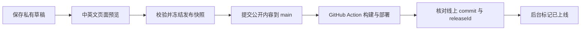

# Super 0→1 CMS 设计草案

日期：2026-10-24。状态：第一阶段已实现；部署与操作以 [CMS 使用说明](cms-guide.md) 为准。

以下保留完整产品设计，其中首页文案、About / Method / Lab、SEO 覆盖、成员管理界面、富文本和逐条选择变更仍是后续范围。第一阶段使用全站草稿版本与整批公开快照；排序由集合顺序表达，正文支持纯文本段落。

## 目标与默认假设

让运营者通过表单维护中英文网站内容，预览修改，并明确知道哪个版本已上线。
第一版按站长与少量团队成员使用设计；编辑者的实际组成仍待确认。
采用现有品牌和页面模板，开放内容字段、推荐位与有限的展示配置。

第一条完整操作链：新增一期 Session → 填写中英文信息、时间、报名链接并上传图片 →
预览详情页与首页 → 发布 → 在后台确认线上版本。

## 当前代码与内容边界

| 当前来源 | 已有能力 | CMS 接入时需要补充 |
| --- | --- | --- |
| `src/content/site.ts` | 名称、使命、YouTube、全局报名链接和联系邮箱 | 统一双语使命；按活动、参与角色配置报名入口 |
| `src/content/programs.ts` | 三个项目板块的简介、按钮、配色预设 | 稳定的板块 ID；与 About 等引用处同步 |
| `src/content/projects.ts` | 项目介绍、作者、阶段、图片、使用步骤、成长记录 | 草稿、排序、推荐、版本、结构化阶段 |
| `src/content/sessions.ts` | 两场历史活动；独立的下一场活动对象 | 统一活动模型，真实时间与时区、活动状态、独立报名链接 |
| `src/content/videos.ts` | 六期视频的 YouTube ID 和单一标题 | 中英文标题、摘要、封面覆盖、推荐与排序 |
| `src/i18n/messages.ts` | 页面文案、导航、方法论、部分 SEO | 分离可编辑内容与界面提示；函数型文案保留在代码中 |
| `src/seo.ts` | 页面元信息、详情页路径、站点地图的数据来源 | 可选 SEO 覆盖；只导出发布内容；空列表处理 |
| 页面组件 | 固定布局、图示、动效；首页直接使用集合数组 | 引用式推荐位、空内容展示、编辑内容与模板解耦 |

现有报名链接和邮箱均为空；填写它们会改变实际报名按钮行为。
首页的视频推荐来自数组第一项，活动与项目卡片直接复用整个集合；这些需改成显式推荐配置。
`Home` 和 `getMeta('/lens')` 都依赖视频第一项，允许后台下架内容前必须修复空列表访问。

## 可编辑模块

下表描述完整目标范围；当前已实现能力见使用说明，不能将此表视为第一阶段功能清单。

| 模块 | 可编辑内容 | 展示与约束 |
| --- | --- | --- |
| 首页 | 首屏标题与强调词、副标题、按钮文案、滚动标语、各区块标题、底部加入邀请 | 推荐活动、视频、项目从集合中选择；允许隐藏可选区块；第一版保持区块顺序 |
| Super Session | 标题、摘要、海报、图片说明、活动时间、时区、地点、报名链接、活动状态、简单活动正文 | 列表、详情页、下一场活动、首页推荐复用同一条记录 |
| Super Lens | YouTube 链接、中英文标题与简介、封面、嘉宾显示名、日期、排序 | 自动解析视频 ID，默认使用 YouTube 缩略图；支持手动覆盖；保留已有详情页 URL |
| Projects | 项目名称、一句话介绍、简介、封面、产品链接、作者信息、阶段、寻找帮助、使用步骤、Problem/Action/Outcome 记录 | 支持新增、编辑、排序、推荐、下架；第一版作者信息仍嵌在项目内 |
| Super Lab | 页面介绍、参与步骤、下一场说明、Builder/Tester 按钮文案及报名目标 | 报名目标支持外链或邮箱；保留现有图示结构 |
| Pearl Method | Thread / Strand / Pearl 的标题、解释，Direction / Product / Go-To-Market 的说明及行动按钮 | 同步首页方法论摘要；三个层次与三个阶段的数量和顺序固定 |
| About | 使命、机构介绍、项目说明、配图、行动按钮 | 使命和三个板块介绍引用共享内容，避免重复维护 |
| 站点设置 | 品牌显示名、联系邮箱、YouTube、默认报名入口、导航显示名称与可见性、页脚文案 | 路由、域名、语言 URL 规则属于部署配置；导航仅选择已有页面 |
| 媒体库 | 上传图片、选择封面、焦点裁切、中英文替代文本、查看使用位置 | 区分草稿原图与公开发布图；被当前或保留历史版本引用的资源不可直接删除 |
| SEO | 页面/内容的中英文标题、摘要、分享图 | 提供自动默认值；canonical、hreflang、站点地图由发布器生成 |

正文编辑器只提供段落、小标题、列表、引用、链接和图片。品牌色、字体、响应式布局、
Pearl 动画和任意 HTML/JavaScript 留在页面模板中维护。板块配色只能从现有预设选择。

## 后台界面

左侧导航：概览、首页、活动、视频、项目、页面文案、媒体库、站点设置、发布记录。
Lab / Method / About 归入「页面文案」，SEO 放在各条内容的编辑页中。

- 概览：当前线上版本、未发布修改、缺少翻译的内容、下一场活动、最近发布结果。
- 列表：标题、内容状态、翻译完成度、首页推荐标记、更新时间；支持筛选、排序、复制。
- 编辑页：顶部「保存草稿 / 预览 / 发布」；主体分为内容、媒体、展示、SEO；中英文并排编辑或切换。
- 右侧预览：桌面/手机、中文/英文；展示该内容影响的页面，例如活动详情页、首页卡片和活动列表。
- 发布面板：列出本次变更、缺失字段、影响页面，并区分「已保存」「发布中」「已上线」「发布失败」。

中文与英文共享 ID、slug、时间、媒体引用、排序和发布状态。第一版一次发布两种语言，
标题和核心介绍必须填写双语；品牌名、人名、产品名可标记为共用。可选段落允许两种语言同时留空。
已增加 AI 中英文翻译草稿：整条内容或单字段生成，编辑者核对并应用后仍需保存和发布。

角色先设为管理员与编辑者：管理员管理成员、设置和发布；编辑者维护草稿与预览。
站长默认是管理员。审核队列和多级审批留待实际协作需求明确后再加。

## 内容模型与规则

所有可重复内容都有稳定 `id`、独立 `revision`、创建/修改记录；URL 使用单独的 `slug`。
已经发布的 slug 第一版锁定；后续改名必须同时生成旧路径跳转。

| 对象 | 第一版核心字段 |
| --- | --- |
| Session | `id, slug, title, summary, body, datePrecision, startsAt, endsAt, timezone, month, location, signupUrl, cover, eventState` |
| Video | `id, youtubeId, title, summary, coverOverride, guestName, publishedDate, sortOrder` |
| Project | `id, slug, name, tagline, summary, cover, builder, stage, lookingFor, links, howItWorks, journey, sortOrder` |
| Home | `hero, marquee, sectionHeadings, featuredSessionIds, featuredVideoIds, featuredProjectIds, visibleSections, join` |
| Site / Page | `localizedCopy, programSummaries, navigation, signupTargets, socialLinks, seo` |
| Media | `id, originalKey, publishedKey, mimeType, width, height, focalPoint, alt, references` |
| Release | `id, schemaVersion, snapshotHash, contentRevisions, gitCommit, actionRunId, status, requestedBy, liveAt, error` |

`eventState`（预告、开放报名、结束、取消）与是否发布是两个维度。结束活动仍可以公开展示。
修改已上线活动会产生新草稿，当前线上版本继续保留；下架也需要一次发布。
历史活动仅有月份，保留 `datePrecision=month`，不编造具体日期；新活动使用时间与 IANA 时区。

报名入口优先级：活动自身链接 → 参与角色专用链接 → 全站链接 → 联系邮箱 → 未开放提示。
外链进行协议和格式校验，不能把未配置的报名按钮标成「报名已开放」。

首页推荐存储内容 ID，不复制标题和图片。发布校验要求推荐项也在本次公开快照内。
原视频 YouTube ID 已作为页面路径使用，导入时保持这些 URL；内部内容 ID 与 YouTube ID 分开。

## 建议的实现方向

沿用当前静态预渲染网站和 `main` 自动部署，新增独立的 CMS 管理 Worker。
建议后台使用 `cms.super0to1.com`；具体域名在实施时配置。

| 组件 | 用途 |
| --- | --- |
| CMS 前端 + Worker API | 表单、预览、服务端校验、发布协调；与公开网站分开部署 |
| D1 | 内容草稿、修订、成员权限、发布记录；作为编辑数据的唯一来源 |
| R2 | 私有原图/草稿资源；公开发布图片使用独立位置及不可变文件名 |
| Cloudflare Access | 管理端与预览入口的身份验证；API 仍执行角色检查，并覆盖其他可访问入口 |
| GitHub App | 仅安装到本仓库，把批准发布的内容快照写入 `main`；不把 GitHub 凭据交给浏览器 |
| 现有 GitHub Action | 校验内容、构建中英文 HTML、部署，并核对线上版本 |

这是基于当前托管方式提出的方案，不代表这些资源已经创建。
Cloudflare 官方支持 Workers 访问 D1；R2 默认不公开，适合把草稿资源与发布资源分开管理。
参考：[D1](https://developers.cloudflare.com/d1/)、[R2 公开访问](https://developers.cloudflare.com/r2/buckets/public-buckets/)、[Workers 与 Access](https://developers.cloudflare.com/workers/configuration/cloudflare-access/)。

现有仓库为 public：草稿、内部联系信息、私有原图与后台成员数据不能写进任何公开分支或构建产物。
发布快照只包含明确允许公开的字段。上线过的内容会留在 Git 历史中，下架不等于从历史中删除。

导出的 `content/published/` JSON 是可复现构建输入，D1 是编辑来源；禁止后台以外的途径直接维护
这份生成文件，避免形成两个内容真源。现有 `src/content/` 模块改成读取快照的适配层。
从 `messages.ts` 迁出营销文案，保留菜单操作提示、无障碍提示和带参数的界面字符串在代码中。

GitHub App 使用限定到本仓库的权限：Contents 写入、Actions 读取等实现所需最小权限；
服务端另外限制可写文件路径。安装访问令牌支持 Git 写入；使用 App 身份提交可触发 push workflow。
参考：[GitHub App 安装身份](https://docs.github.com/en/apps/creating-github-apps/authenticating-with-a-github-app/authenticating-as-a-github-app-installation)、[工作流触发规则](https://docs.github.com/en/actions/how-tos/write-workflows/choose-when-workflows-run/trigger-a-workflow)。

## 保存、预览、发布与回退

1. 保存只更新私有草稿，使用 revision 检测多人编辑冲突。
2. 预览用同一套页面组件和内容 schema，在受保护页面读取指定草稿修订；响应不缓存并标记 noindex。
3. 点击发布选择本次变更，其他记录继续使用上一线上版本；进行双语、链接、媒体、引用和 schema 校验。
4. 冻结不可变快照及资源引用，生成公开 JSON，一次提交写入全部变更。Git 更新检查 main 当前 HEAD，冲突时重读并校验，不能强推。
5. 第一版同一时间只允许一个 CMS 发布进行；可继续编辑下一份草稿，重复点击用发布 ID 去重。
6. Action 使用仓库内快照构建；构建后的 marker 同时写入 commit 和 releaseId。CMS 按确切 commit 读取 Action 结果，并核对线上 marker，才更新线上版本指针。
7. 发布失败要区分部署前失败与部署后验证失败：前者通常保留旧站；后者可能已改变线上内容，必须显示「线上状态待核对」。修复后重试同一快照，或重新发布上一成功内容版本。
8. 内容回退将历史内容快照作为一次新发布，保留当前代码和凭据，不执行整仓库强制回退。旧媒体保留以支持回退。

发布前校验为快速反馈，CI 再做一次最终校验。提交成功和上线成功必须是两个状态。
纯代码 main 更新沿用已有发布快照；因此 CMS 以 releaseId 判断内容版本，以 commit 判断部署版本。

## 分期与验收

**第一阶段：完整发布链。** 建立登录、草稿/修订、媒体、预览、发布记录；接入 Session、Lens、Projects、
首页推荐和报名设置。先完成一条新活动从编辑到线上可核对的全流程。

**第二阶段：完整文案覆盖。** 接入首页首屏、About、Lab、Method、导航与 SEO；补齐安全的空区块展示和双语排版预览。

**后续按需要增加。** 定时发布、审批分工、人物库、YouTube 批量导入、AI 翻译/摘要和首页区块排序。
报名名单、支付、CRM 与站点内容编辑分别评估，当前阶段继续使用外部报名入口。

关键验收：

- 无需改代码即可新增活动或视频，并同步列表、详情页和首页推荐。
- 保存草稿不影响线上；未登录者无法访问草稿页面、API 或草稿媒体。
- 缺少必要翻译、无效链接、未发布推荐项能在对应字段指出问题。
- 清空视频列表、下架最后一个项目或没有下一场活动时，构建和网站均正常。
- 预览与发布使用同一份冻结内容；桌面/手机和中英文页面均可检查。
- CMS 展示的上线版本与实际 Cloudflare 内容一致；失败不会被标成成功。
- 可以恢复上一版内容，并保留之后的未发布编辑。
- 第一轮导入后，现有 URL、语言跳转、SEO、首页布局与图示行为保持一致。

本草案只新增设计文档；未创建 CMS 数据库、后台服务或新线上页面。
